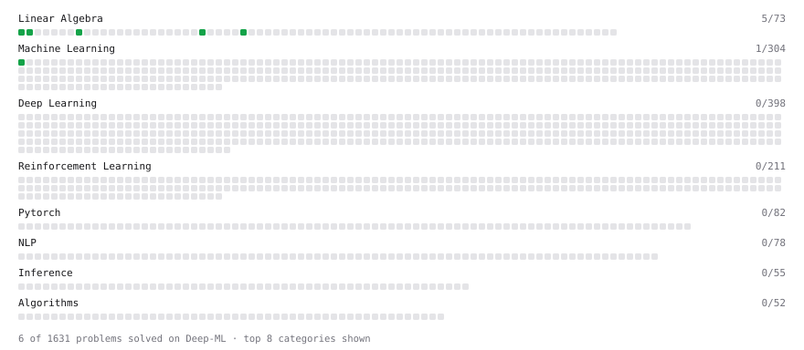

# Deep-ML

My machine learning practice from [Deep-ML](https://www.deep-ml.com). Every solution here was written by hand.

**8** solved · 6 problems · 0 labs · 2 math

[**Browse the interactive portfolio**](https://sarthaksec.github.io/deep-ml/) to replay this filling in over time.

## Problems

| | Difficulty | Solved | |
| --- | --- | --- | --- |
| [Calculate 2x2 Matrix Inverse](https://www.deep-ml.com/problems/8) | easy | 2026-10-23 | [solution](problems/0008-calculate-2x2-matrix-inverse) |
| [Dot Product Calculator](https://www.deep-ml.com/problems/83) | easy | 2026-10-20 | [solution](problems/0083-dot-product-calculator) |
| [Implement Orthogonal Projection of a Vector onto a Line](https://www.deep-ml.com/problems/66) | easy | 2026-10-24 | [solution](problems/0066-implement-orthogonal-projection-of-a-vector-onto-a-line) |
| [Linear Regression Using Normal Equation](https://www.deep-ml.com/problems/14) | easy | 2026-10-24 | [solution](problems/0014-linear-regression-using-normal-equation) |
| [Matrix-Vector Dot Product](https://www.deep-ml.com/problems/1) | easy | 2026-10-20 | [solution](problems/0001-matrix-vector-dot-product) |
| [Transpose of a Matrix](https://www.deep-ml.com/problems/2) | easy | 2026-10-23 | [solution](problems/0002-transpose-of-a-matrix) |

## Math

| | Difficulty | Solved | |
| --- | --- | --- | --- |
| [Inverse and Rank](https://www.deep-ml.com/math-problems/12) | medium | 2026-10-23 | [solution](math/0012-inverse-and-rank) |
| [Orthogonality and Projections](https://www.deep-ml.com/math-problems/14) | medium | 2026-10-23 | [solution](math/0014-orthogonality-and-projections) |

---

_This file is regenerated by Deep-ML on every push._
